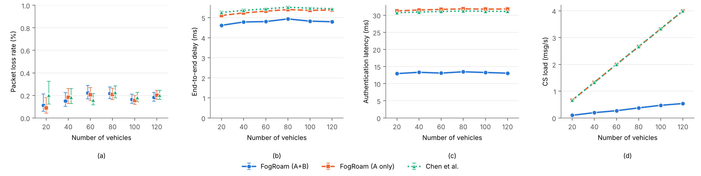

# 5G NR simulation of FogRoam (Tarragona, Spain)

Simu5G/INET/Veins/SUMO/OMNeT++ simulation used in the paper
*"FogRoam: Cloud-Free Handover Authentication for B5G Vehicular Networks"*. The B5G
architecture of the paper is simulated with 5G settings: the FogRoam authentication protocol
runs over a 5G NR standalone radio access network. Vehicles are NR user equipments driven by SUMO, every
fog node is co-located with a gNB, and the cloud server is reached over a backhaul link.
Three configurations are compared:

| Configuration | Protocol |
|---------------|----------|
| `Proposed`  | FogRoam: phase A (cloud-assisted, messages M1–M4) and phase B (cloud-free handover, messages M5–M6) |
| `ProposedA` | FogRoam restricted to phase A |
| `Baseline`  | the protocol of Chen et al. analysed in the paper (messages M1–M4) |
| `ProposedHO`, `BaselineHO` | as `Proposed` and `Baseline`, but sessions are triggered by the mobility: when a vehicle joins, at every change of its serving gNB, and when its last phase A (full run) is older than 300 s |
| `ProposedHO150`, `ProposedHO600` | `ProposedHO` with a phase-A re-validation interval of 150 s and 600 s |

## Software

| Component | Version | Role |
|-----------|---------|------|
| OMNeT++   | 6.0.3 (Cmdenv only) | discrete-event simulator |
| INET      | 4.5.2 | IPv4, UDP, SCTP (X2), PPP links |
| Simu5G    | 1.2.2 | 5G NR user plane: PDCP, RLC, MAC (HARQ, scheduling, link adaptation), PHY and channel models, handover |
| Veins     | 5.3.1 (`veins_inet` subproject) | coupling with SUMO over TraCI |
| SUMO      | 1.20.0 | road traffic |
| Xerces-C  | 3.2.5 | required by SUMO |

Simu5G 1.2.2 is the Simu5G release for OMNeT++ 6.0.x and INET 4.5. No source file of
OMNeT++, INET, Simu5G, Veins or SUMO is modified; all protocol logic is in `fogroam5g/`.

```bash
build/fetch.sh       # OMNeT++, SUMO, Veins, Xerces-C, flex          -> ./src
build/fetch5g.sh     # INET 4.5.2 and Simu5G 1.2.2                   -> ./src
build/build.sh       # builds OMNeT++, SUMO and Veins (no root rights needed)
build/build5g.sh     # builds INET (required features only), Simu5G, veins_inet and fogroam5g
```

The scripts use the repository folder as `$SIM`; set `SIM=/other/path` to change it.
`build5g.sh` takes about 20 minutes on two cores (`JOBS=N` changes the number of jobs).
A build made from scratch with these scripts gives scalar results identical to those of the
build used for the results below.

## Mapping of the protocol entities to the 5G system

| Protocol entity | Simulation module | Notes |
|-----------------|-------------------|-------|
| Vehicle V_i | `simu5g.nodes.cars.NRCar` with `AkaVehicleApp5G` | NR UE; mobility from SUMO (`VeinsInetMobility`) |
| Fog node F_j | `StandardHost fog[j]` with `AkaFogApp5G`, co-located with `gnb[j]` | reached through the user-plane function of the edge site (5 µs links) |
| Cloud server CS | `StandardHost cloud` with `AkaCloudApp5G` | 1 Gbps backhaul with 10 ms delay |
| Messages M1, M5 | UDP datagrams in the NR uplink | scheduling request, grant, HARQ |
| Messages M4, M6 | UDP datagrams in the NR downlink | |
| Messages M2, M3 | UDP datagrams between F_j and CS | wired |

The fog node of a vehicle is the one at its serving gNB, which the vehicle reads from its NR
physical layer (`LtePhyUe::getMasterId()`); when the UE is handed over to another gNB, its
next authentication is run with the fog node of the new cell. With `Proposed` this is a
phase B run (cloud-free) as long as the last phase A of the vehicle is not older than 300 s.

## Scenario

* Road network and building footprints of the city centre of Tarragona
  (OpenStreetMap extract `map/tarragona.osm.xml`, 41.104–41.126 N, 1.229–1.264 E),
  converted with `netconvert` and `polyconvert` by `map/prepare_map.sh`.
  The simulated area is 3.7 km × 2.0 km.
* 4 gNB sites with co-located fog nodes (Plaça de la Imperial Tàrraco, Rambla Nova,
  Avinguda de Roma, Avinguda de Catalunya), X2 full mesh between the gNBs.
* 20, 40, 60, 80, 100 and 120 vehicles on random routes (`randomTrips.py`, minimum trip
  length 1200 m). Vehicles of SUMO type `ext` enter from the map edge and were authenticated
  by a fog node outside the area before (their last phase A is uniform in the past 300 s).
* Every vehicle authenticates with the fog node of its serving cell every 30 ± 7.5 s. With
  `Proposed`, phase A is run when the vehicle joins and whenever its last phase A is older
  than 300 s, and phase B otherwise. A session fails if it is not completed within 1 s.
  With the `...HO` configurations (`authTrigger = "handover"`), a vehicle instead starts a
  session when it joins, when its serving gNB changes, and when its last phase A is older
  than `phaseAValidity`; the latency of the sessions that follow a handover is recorded
  separately (`latAho_ms`, `latBho_ms` in `analysis/summary5g.json`).
* Every vehicle sends a 250-byte cooperative awareness message (CAM) to its fog node at
  10 Hz as background uplink traffic.
* Message sizes (bits) and processing delays (ms) are set in `scenario/omnetpp.ini` at the 128-bit
  security level (secp256r1, SHA-256, AES-256, 256-bit field for the polynomial shares), from the
  operation counts of Table V of the paper and the execution times measured with `bench/bench256.c`
  (`cd bench && python3 sim_delays5g.py` prints the delays, `python3 costs128.py` the sizes). Fog nodes and CS process the messages in
  FIFO order.
* 900 s per run, statistics collected after a 300 s warm-up, 10 seeds per configuration
  (95 % confidence intervals of the mean over the seeds, Student t).

### Radio access network

| Parameter | Value |
|-----------|-------|
| Radio access | 5G NR standalone, one carrier, FDD |
| Carrier | 2.1 GHz (band n1), 20 MHz, 30 kHz subcarrier spacing (numerology 1, 0.5 ms slots), 51 resource blocks per direction |
| Transmit power | gNB 46 dBm, vehicle 23 dBm |
| Antennas | gNB 18 dBi at 25 m, omnidirectional; vehicle 3 dBi at 1.5 m (3GPP TR 37.885) |
| Noise figure | gNB 5 dB, vehicle 9 dB (3GPP TR 37.885) |
| Path loss | 3GPP TR 38.901 urban macro-cell (UMa) with distance-dependent LOS probability |
| Shadowing and fading | log-normal shadowing (50 m correlation distance), Jakes fast fading |
| Interference | inter-cell interference in both directions (all gNBs use the same carrier) |
| Link adaptation | NR CQI/MCS tables (`NRAmc`), target BLER 0.01, CSI report every 40 ms |
| HARQ | 8 processes, up to 3 retransmissions |
| RLC | unacknowledged mode, reassembly timer 50 ms |
| Scheduler | proportional fair in both directions |
| Mobility management | attachment to the strongest gNB, handover with 50 ms interruption, X2 |

Deviations from the Simu5G defaults, and why:

* `dynamic_los`, `downlink_interference` and `uplink_interference` are enabled, since by
  default Simu5G treats every link as NLOS and ignores the other cells.
* `targetBler = 0.01` and `blerShift = 5` as in the NR scenarios shipped with Simu5G.
* `fbPeriod = 40` (CSI report every 40 ms instead of 6 ms) to keep the run time acceptable.
* The RLC UM reassembly timer is 50 ms instead of 1 s. With the default, every residual
  HARQ failure stalls the uplink of that vehicle for up to 1 s, which no NR configuration
  for delay-sensitive traffic uses (t-Reassembly in 3GPP TS 38.331 is at most 200 ms).
* Simu5G models an FDD carrier by default. Its TDD option divides every slot into downlink
  and uplink symbols; it produced multi-second uplink stalls in this scenario and is not used.

## Running

```bash
cd scenario
./run.sh Proposed 0              # one run; run numbers 0..59 = 6 densities x 10 seeds
python3 runset.py 20,40,60,80,100,120 2     # Proposed, ProposedA and Baseline, 2 in parallel, resumable
./campaign.sh                    # all runs of the paper in the order in which they were made
cd ..
python3 analysis/parse5g.py results analysis/summary5g.json analysis/summary5g.csv
python3 analysis/make_fig5g.py analysis/summary5g.json figs/results5g.png
python3 analysis/make_tex5g.py analysis/summary5g.json fig_sim.tex
```

The scenario figure (`figs/tarragona_sim5g.png`) shows the serving gNB of every vehicle at
t = 600 s, after the 300 s warm-up, recorded by the simulation itself.
`results/snapshot/Proposed-N100-r0-t600.sca` is a copy of `scenario/snapshot600/Proposed-N100-r0.sca`
written by

```bash
cd scenario
./run.sh Proposed 40 --sim-time-limit=601s --result-dir=snapshot600 "--**.app[*].snapshotTime=600s"
cd ..
python3 analysis/make_map5g.py scenario/tarragona_center.net.xml scenario/tarragona_center.poly.xml \
  results/snapshot/Proposed-N100-r0-t600.sca figs/tarragona_sim5g.png
```

`snapshotTime` is off by default and draws no random numbers, so it does not change any result.

`runset.py` writes the results to `scenario/results/` (copy them to `results/` or pass that
folder to `parse5g.py`). SUMO is started by the simulation itself (`VeinsInetManagerForker`).
A 900 s run takes about 6 minutes for 20 vehicles, 30 minutes for 100 vehicles and 40 minutes
for 120 vehicles on one core of an Intel Xeon at 2.1 GHz (two runs in parallel on two cores);
the 54 runs take about 20 core-hours. `runset.py` takes an optional time budget in minutes as
fourth argument and only starts runs that are expected to finish within it; with
`LARGE_FIRST=1` it starts the longest runs first. A run counts as complete only when its log
in `scenario/runlogs/` reports that the 900 s time limit was reached.

The fog-node application records the delay of every received request and CAM as output
vectors (`akaReqDelayA`, `akaReqDelayB`, `akaCamDelay`). Vector recording is off by default;
`./run.sh Proposed 0 "--**.app[*].aka*.vector-recording=true"` enables it, and
`analysis/vecstats.py <file.vec>` prints their percentiles.

## Metrics

* **Authentication latency**: time from the start of a session at the vehicle to the
  establishment of the session key, including processing, radio access and backhaul delays.
* **Packet loss rate**: fraction of the over-the-air protocol messages (M1, M4, M5, M6)
  that are not received by their destination, over all messages of the three seeds, with
  its 95 % Wilson interval (only a few messages are lost per run).
* **End-to-end delay**: time from the transmission of an over-the-air protocol message by
  the application of the sender to its reception by that of the receiver.
* **Cloud load**: number of messages M2 processed by the cloud server per second.
* **Success ratio**: fraction of the started sessions that are completed within 1 s.
* Radio KPIs recorded by Simu5G: SINR, CQI, HARQ error rates, MAC packet loss.

## Results

**The table below is from the earlier campaign (80-bit operation times, three seeds); it will be
replaced by the results of the 128-bit campaign with ten seeds.**

Mean over three seeds (latency: mean ± standard deviation over the seeds; loss: all messages of the three seeds,
with the 95 % Wilson interval, since only 0 to 12 protocol messages are lost per run). `analysis/summary5g.json` and
`analysis/summary5g.csv` contain all metrics, `figs/results5g.png` the figure and `figs/tarragona_sim5g.png` the scenario.

| N | Scheme | Latency (ms) | Phase A (ms) | Phase B (ms) | Phase B share | Loss (95 % interval) | Success | CS load (msg/s) |
|---|--------|-------------:|-------------:|-------------:|--------------:|-----:|--------:|----------------:|
| 20 | FogRoam (A+B) | 12.85 ± 0.46 | 31.86 | 9.65 | 85.5 % | 0.21 % (0.09–0.48) | 99.6 % | 0.097 |
| 20 | FogRoam (A only) | 31.26 ± 0.18 | 31.26 | – | 0.0 % | 0.08 % (0.02–0.30) | 99.8 % | 0.666 |
| 20 | Chen et al. | 28.97 ± 0.05 | 28.97 | – | 0.0 % | 0.08 % (0.02–0.31) | 99.8 % | 0.662 |
| 40 | FogRoam (A+B) | 12.88 ± 0.18 | 31.73 | 9.67 | 85.4 % | 0.08 % (0.03–0.21) | 99.8 % | 0.195 |
| 40 | FogRoam (A only) | 31.57 ± 0.18 | 31.57 | – | 0.0 % | 0.15 % (0.07–0.30) | 99.7 % | 1.337 |
| 40 | Chen et al. | 29.27 ± 0.16 | 29.27 | – | 0.0 % | 0.17 % (0.08–0.33) | 99.7 % | 1.333 |
| 60 | FogRoam (A+B) | 12.94 ± 0.12 | 32.34 | 9.94 | 86.6 % | 0.15 % (0.09–0.27) | 99.7 % | 0.266 |
| 60 | FogRoam (A only) | 31.62 ± 0.15 | 31.62 | – | 0.0 % | 0.11 % (0.06–0.22) | 99.8 % | 1.999 |
| 60 | Chen et al. | 29.65 ± 0.09 | 29.65 | – | 0.0 % | 0.25 % (0.16–0.39) | 99.5 % | 2.002 |
| 80 | FogRoam (A+B) | 13.33 ± 0.08 | 33.29 | 10.06 | 85.9 % | 0.15 % (0.09–0.25) | 99.7 % | 0.373 |
| 80 | FogRoam (A only) | 31.89 ± 0.09 | 31.89 | – | 0.0 % | 0.21 % (0.14–0.32) | 99.6 % | 2.644 |
| 80 | Chen et al. | 29.71 ± 0.07 | 29.71 | – | 0.0 % | 0.17 % (0.10–0.27) | 99.7 % | 2.658 |
| 100 | FogRoam (A+B) | 12.96 ± 0.28 | 32.39 | 9.75 | 85.8 % | 0.10 % (0.06–0.18) | 99.8 % | 0.471 |
| 100 | FogRoam (A only) | 31.56 ± 0.24 | 31.56 | – | 0.0 % | 0.18 % (0.12–0.27) | 99.6 % | 3.324 |
| 100 | Chen et al. | 29.46 ± 0.28 | 29.46 | – | 0.0 % | 0.15 % (0.10–0.24) | 99.7 % | 3.311 |
| 120 | FogRoam (A+B) | 12.90 ± 0.29 | 32.25 | 9.88 | 86.4 % | 0.22 % (0.15–0.31) | 99.6 % | 0.536 |
| 120 | FogRoam (A only) | 31.53 ± 0.22 | 31.53 | – | 0.0 % | 0.10 % (0.06–0.16) | 99.8 % | 3.993 |
| 120 | Chen et al. | 29.45 ± 0.34 | 29.45 | – | 0.0 % | 0.20 % (0.14–0.28) | 99.6 % | 3.982 |

Compared with the baseline, FogRoam reduces the mean authentication latency by 55.1–56.4 % (mean 55.9 %) and the load of the cloud server by 85.4–86.7 % (mean 86.0 %).

Radio KPIs averaged over all runs of `Proposed`: uplink SINR 21.5 dB, downlink SINR 43.7 dB, uplink CQI 11.6, downlink CQI 14.3, first-transmission block error rate 18.9 % (uplink) and 1.6 % (downlink), residual MAC loss after HARQ 0.33 % (uplink) and 0.00 % (downlink), CAM delivery ratio 99.40 % with a mean delay of 8.57 ms.



## Layout

```
fogroam5g/   OMNeT++ project (src/): AkaVehicleApp5G, AkaFogApp5G, AkaCloudApp5G, AkaMessages5G.msg,
             network Tarragona5G; build with build/build5g.sh
scenario/    omnetpp.ini, address plan, SUMO inputs, run.sh, runset.py
map/         OpenStreetMap extract and prepare_map.sh
analysis/    parse5g.py (aggregation), make_fig5g.py and make_tex5g.py (result figures), make_map5g.py (scenario figure), vecstats.py
bench/       bench256.c (operation timings at the 128-bit level), ops128.json (measured times),
             sim_delays5g.py and costs128.py (costs, message sizes, and processing delays of Tables V and VI),
             bench_pairing.c and costs_ho.py (pairing, Chebyshev, and handover costs of Table VII)
build/       fetch.sh, build.sh, fetch5g.sh, build5g.sh
results/     OMNeT++ scalar results of all 54 runs (.sca); snapshot/ for the scenario figure
figs/        result and scenario figures
```

## Earlier IEEE 802.11p version

The GitHub repository also contains, in `ieee80211p/`, an earlier simulation of the same
scenario with Veins and IEEE 802.11p roadside units instead of a 5G NR network. With
802.11p, FogRoam reduces the authentication latency by 63–68 % and the load of the cloud
server by 71–77 % compared with the baseline, at packet loss rates of 2.3–6.9 %.
